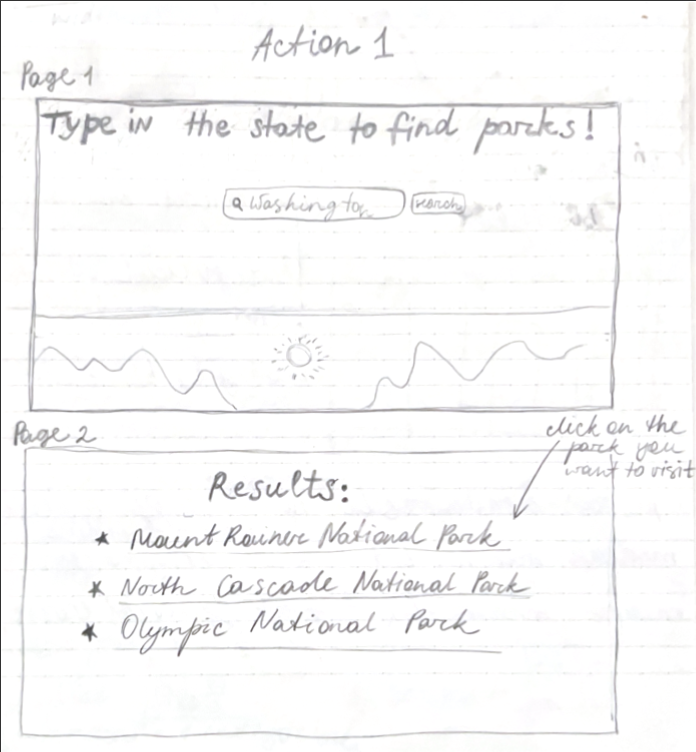

## 1. The design problem, audience and value
 This app is for park visitors who want to go camping or do other activities at a national park but want to be prepared for the weather conditions at the park or to visit the park during specific weather conditions. This web app will help them to find weather conditions at a specific national park on a specific day or days within the next 2 weeks. This enables visitors (hikers, campers, etc) to dress appropriately for the weather and plan accordingly in other ways (such as bringing appropriate camping gear). Our users will also be able to sign up for email alerts from the National Park Service regarding park closures, severe weather, and other hazards at the saved park.
Our app will provide visitors, hikers, and campers with park and weather information all in one place, so they can easily plan their trip and choose to visit a national park when the weather is more ideal for them. In addition, the app sends National Park Service alerts for a specific park(s) straight to the user’s email instead of requiring the user to check the NPS website to view these alerts.

## 2. Depth item
 Our depth item is “Acts over time” because our app will give the user alerts from the National Park Service regarding park closures and severe weather at the saved park to aid the user in their trip planning. The new piece the app needs is a timer that will allow the app to periodically check for alerts from the National Park Service so that these alerts can be sent to the user’s email address (which they will use to login to our web app and save the park(s) they want to save). Success criterion: user receives alert message within 2 hours of a new alert being available for the saved National Park from the National Park Service website.

## 3. User Flow
## Action 1
|Steps| User does:     | App’s response:    | User sees:   |
| --- | -------------- | ------------------ | ------------ |
| 1.  | Writes a state into the search bar| Looks up for parks from the searched state, asks NPS for park information.|      Loading for matching parks from the selected state|
| 2.  | Waits          | Loads the list of all parks from the selected state and the information (weather and the filter) | A list of parks in the specific state a user can click on  |

## Action 2
|Steps| User does:     |App’s response:     | User sees:
| --- | -------------- | ------------------ | ------------ |
| 1.  | Clicks on the park that interested them |Gets the park’s campground and activities from NPS, and gets the weather for that date from Open-Meteo | Loading for matching parks from the selected state
| 2. |Click on the weather calendar and choose a start date and an end date | Connecting the selected date with Open-Meteo API |Show the weather for the specific selected date
     
## Action 3
Steps| User does:     |App’s response:      |User sees:
| --- | -------------- | ------------------ | ------------ |
| 1.  | Can input email to sing up for alerts  |Checks if the email is in the right format, saves email address in json file, sends a confirmation email| Loading for matching parks from the selected state
| 2.  | When NPS has a new alert for a park user saved, user gets an alert email about that park |Checks NPS every 2 hours and sends an email if there are any new alerts about the park user wants to visit| See the email -- “New alert is posted..."

## 4. Data sources
Data source: Open-Meteo API
Docs link: https://open-meteo.com/en/docs
What we use it for: For weather information (Maximum Temperature, Minimum Temperature, UV Index, Maximum Wind Speed, Precipitation Probability Max).
Key or limits: Rate limits: 600 calls per minute or 5000 calls per hour. No API key, no cost.
The call: fetchmeteo.py (this is an example and not the final form)
Real response:
Date: 2026-11-21
Max Temperature: 29.5 degrees Fahrenheit
Min Temperature: 20.5 degrees Fahrenheit
UV Index: 1.45
Max Wind Speed: 2.9 mph
Max Precipitation Probability: 0%

Date: 2026-11-22
Max Temperature: 30.7 degrees Fahrenheit
Min Temperature: 20.8 degrees Fahrenheit
UV Index: 1.4
Max Wind Speed: 3.1 mph
Max Precipitation Probability: 0%

https://open-meteo.com/
Weather data by Open-Meteo.com

What we noticed/were surprised by: We noticed that we can choose start and end dates for the weather information and so we will use those parameters to allow our user to choose dates for the weather to be shown from (we just need to link it somehow). We also notice that Open Meteo automatically displays information in metric units and, since the imperial system is used more broadly in the US, we made the units in imperial form instead.

Data source: NPS API
Docs link: https://www.nps.gov/subjects/developer/api-documentation.htm#/
What we use it for: Finding National Parks as well as campground information and things to do at the parks.
Key or limits: API key is needed but can be gotten from NPS for free. Rate limit: 1000 requests per hour. No cost.
The call: In fetchnps.py (this is an example and not the final form)
Real response: Name: Fairholme Campground
Description: Neighboring Lake Crescent, Fairholme includes lakeside campsites and a nearby boat launch.
Name: Graves Creek Campground
Description: Located in the Quinault Rain Forest, relax near a serene stream at Graves Creek Campground.
Name: Kalaloch Campround
Description: Oceanside camp at Kalaloch with some sites overlooking the Pacific Ocean. Online reservations accepted for peak season. Check recreation.gov for current season dates. All sites are first-come, first-served in off season.
Name: Heart O' the Hills Campground
Description: Surrounded by old growth forest, Heart O' the Hills offers summer ranger programs and great family fun

What we noticed/were surprised by: We changed the stateCode in the parameters to “q”: user_input and when we typed “Washington” in the terminal it gave us anything related to the name Washington, not necessarily just parks from the state. It seems that we can get park names from Washington state only by typing the abbreviation “WA”. We also experimented with putting “stateCode”: user_input and found that if we entered “Washington” we got an empty list, but if we entered “WA” it gave us accurate results for parks in WA state. We will be keeping all of this in mind when it comes to refining our search bar for our final project.

## 5. Data model
|Noun | What it holds | How they relate | Saved? Why?|
| --- | --------------| --------------- | ---------- |
|State| parks | Holds list of park names | Yes, saved in state.json to improve search speed (saving makes the second search for that state faster)|
|Park | fullName, activities, addresses, descriptions,
|Images | Holds info about the parks | Yes, saved in park.json to improve search speed (saving makes the second search for that park faster)|
|Campgrounds | name, description, latitude, longitude, reservationUrl | Holds info about the campgrounds| No, asked fresh from NPS each search|
| Thingstodo| title, locationDescription, shortDescription| Holds info about things to do at a park | No, asked fresh from NPS each search|
|Weather| Max Temperature, Min Temperature, longitude, latitude, start_date, end_date| Holds weather related info| No, asked fresh from Open-Meteo each search|
|Dates| start_date, end_date| Holds date info| No, get dates from /park-info|
|Email | email address| Holds email information for alerts to be sent to| Saved (not sure how to properly save this data yet, is saving in a json acceptable?)

