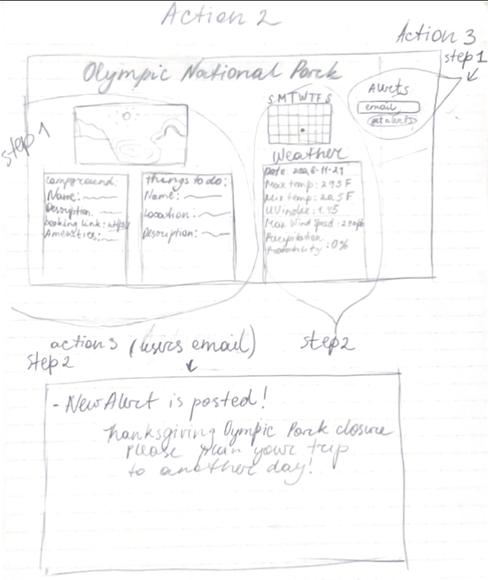

1. This app is for park visitors who want to go camping or do other activities at a national park but want to be prepared for the weather conditions at the park or to visit the park during specific weather conditions. This web app will help them to find weather conditions at a specific national park on a specific day or days within the next 2 weeks. This enables visitors (hikers, campers, etc) to dress appropriately for the weather and plan accordingly in other ways (such as bringing appropriate camping gear). Our users will also be able to sign up for email alerts from the National Park Service regarding park closures, severe weather, and other hazards at the saved park.
Our app will provide visitors, hikers, and campers with park and weather information all in one place, so they can easily plan their trip and choose to visit a national park when the weather is more ideal for them. In addition, the app sends National Park Service alerts for a specific park(s) straight to the user’s email instead of requiring the user to check the NPS website to view these alerts.

2. Our depth item is “Acts over time” because our app will give the user alerts from the National Park Service regarding park closures and severe weather at the saved park to aid the user in their trip planning. The new piece the app needs is a timer that will allow the app to periodically check for alerts from the National Park Service so that these alerts can be sent to the user’s email address (which they will use to login to our web app and save the park(s) they want to save). Success criterion: user receives alert message within 2 hours of a new alert being available for the saved National Park from the National Park Service website.

3. 
<<<<<<< HEAD

## Action 1
|Steps| User does:     | App’s response:    | User sees:   |
| --- | -------------- | ------------------ | ------------ |
| 1.  | Writes a state into the search bar| Looks up for parks from the searched state, asks NPS for park information.|      Loading for matching parks from the selected state|
| 2.  | Waits          | Loads the list of all parks from the selected state and the information (weather and the filter) | A list of parks in the specific state a user can click on  |

## Action 2
|Steps| User does:     |App’s response:     | User sees:
| --- | -------------- | ------------------ | ------------ |
| 1.  | Clicks on the park that interested them |Gets the park’s campground and activities from NPS, and gets the weather for that date from Open-Meteo | Loading for matching parks from the selected state
| 2. |Click on the weather calendar and choose a start date and an end date | Connecting the selected date with Open-Meteo API |Show the weather for the specific selected date
     
## Action 3
Steps| User does:     |App’s response:      |User sees:
| --- | -------------- | ------------------ | ------------ |
| 1.  | Can input email to sing up for alerts  |Checks if the email is in the right format, saves email address in json file, sends a confirmation email| Loading for matching parks from the selected state
| 2.  | When NPS has a new alert for a park user saved, user gets an alert email about that park |Checks NPS every 2 hours and sends an email if there are any new alerts about the park user wants to visit| See the email -- “New alert is posted..."

=======
## Action 1
Steps| User does:     | App’s response:    | User sees:
---------------------------------------------------------
1.   | Writes a state | Looks up for parks | Loading for
     | into the search| from the searched  | matching 
     | bar            | state, asks NPS    | parks from
     |                | for park           | the selected
     |                | information.       | state
---------------------------------------------------------
2.   | Waits          | Loads the list of  | A list of
     |                | all parks from the | parks in the
     |                | selected state and | specific 
     |                | the information    | state a user
     |                | (weather and the   | can click on
     |                | filter)            |
----------------------------------------------------------

## Action 2
Steps| User does:     |App’s response:     | User sees:
----------------------------------------------------------
1.   | Clicks on the  |Gets the park’s     | Loading for
     | park that      |campground and      | matching 
     | interested     |activities from NPS,| parks from
     | them           |and gets the        | the selected
     |                |weather for that    | state
     |                |date from Open-Meteo|
-----------------------------------------------------------
2.   |Click on the     | Loads the list of  |Show the 
     |weather calendar |Connecting the      |weather for 
     |and choose a     |selected date with  |the specific
     |start date and an|Open-Meteo API      |selected 
     |end date         |                    |date
 ----------------------------------------------------------    
## Action 3
Steps| User does:     |App’s response:      |User sees:
-----------------------------------------------------------
1.   | Can input email|Checks if the email  |Loading for
     | to sign up for |is in the right      |matching 
     | alerts         |format, saves email  |parks from
     |                |address in json file,|the selected
     |                |sends a confirmation |state
     |                |email                |
------------------------------------------------------------
2.   |When NPS has a  |Checks NPS every 2  |See the email
     |new alert for a |hours and sends an  |-- “New
     |park user saved,|email if there are  |alert is 
     |user gets an    |any new alerts about|posted..."
     |alert email     |the park user wants |
     |about that park |to visit            |
------------------------------------------------------------
>>>>>>> 653092784ec0c9235d85baaec4c1a4e527dcb637

