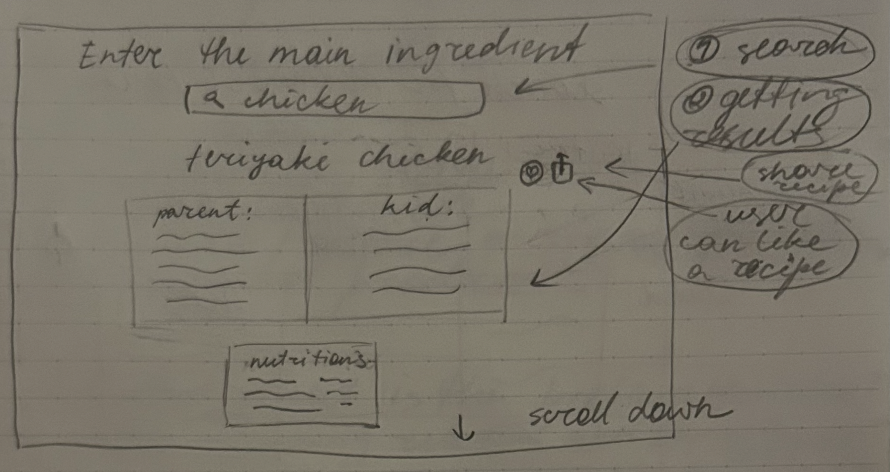
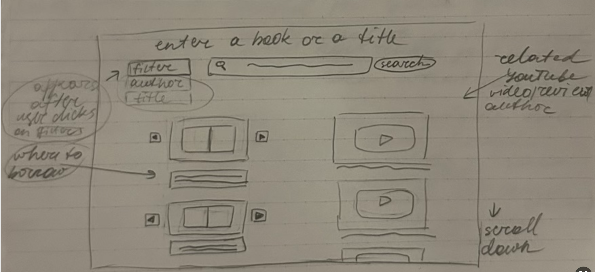
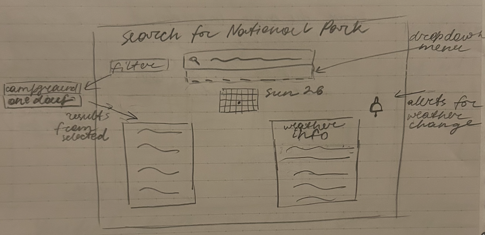

Concept 1: 
Audience and value: A web app that allows parents to generate two versions of a recipe: the orginal, adult friendly recipe and a simplified, kid friendly version. This would help parents who tend to cook two separate meals (one for themselves, and one for their children who may be picky and want plainer food) be able to use the same base ingredients for each meal, saving time and money.
Key moment sketch: 
Data: TheMealDB API and Spoonacular API.
Depth item: Many lenses, since the user can see recipes, kid friendly versions, instructions, nutrition, and cost info.
User flow: user can login in order to save recipes —> user enters main ingredient (such as “chicken”) into search bar —> user is presented with several recipe options, each with the primary recipe on the left side of the screen and the kid-friendly version of the sane recipe on the right side of the screen —> user can select desired recipe to view in more detail —> user can “heart” a recipe to save it if they desire.

Concept 2:
Audience and value: A web app that allows book lovers the ability to look up books, be able to borrow them online, and also to see videos related to that book (book reviews, author interviews, "read along" videos, etc.), making it easy to interact with books in multiple different ways all in one place. The user can also save favorites.
Key moment sketch: 
Data: Open Library API and YouTube Data API.
Depth item: Many lenses, since the user can get information about the books themselves and also YouTube videos with a variety of book related topics.
User flow: user can enter the title of a book or an author name in the search bar (with a drop down menu to filter the search to look for title or author) —> get results that include books at the left side of the screen and related YouTube videos to the right of the screen —> user can click on the book and learn how to borrow an ebook version or can click on a YouTube video to watch it —> user can save favorites.

Concept 3:
Audience and value: A web app that allows people who want to go hiking or camping at a national park learn information about the parks but also find out what the weather will be like at the park based on dates they choose that are in the near future. This enables hikers and campers to plan ahead and choose to visit a national park when the weather is more ideal for them. The user can save their visit information to refer back to later and also receive severe weather alerts.
Key moment sketch: 
Data: Open Meteo API and NPS API
Depth item: Acts over time, since the user can receive severe weather alerts.
User flow: user can enter a national park name in the search bar (or perhaps select a park name from a drop down menu) and filter for campgrounds or hike information —> get results based on search and have the option to choose dates within two weeks in the future —> if dates are chosen, weather information for those dates at that park location are displayed —> user can save park and date info to refer back to.
